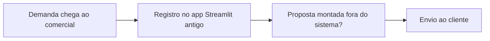

# Descoberta — Zetta Propostas

## Sobre o cliente
- O "cliente" é a própria Zetta: equipe pequena, perfis **administrador** e **comercial** (observado na tabela `equipe`).
- Quem usa: sócios e quem fizer atendimento comercial.
- Possível uso futuro como produto para outras PMEs — _A definir_ (P-03).

## Como trabalham hoje (AS-IS)
_A definir._ O código mostra o processo que o app assume, mas não como a Zetta faz hoje fora dele. O guia de publicação indica que existe uma versão anterior em Streamlit usando o mesmo Supabase, com clientes já cadastrados.

Fluxo provisório — confirmar com José (P-04).

## Dores
| # | Dor | Quem sente | Impacto | Fonte |
|---|-----|-----------|---------|-------|
| 1 | _A definir_ | | | |

## Números que importam
_A definir._ Quantas propostas por mês, ticket médio, taxa de conversão atual.

## Restrições
- 📌 Custo zero de infraestrutura: Cloudflare Pages Free + Supabase Free + GitHub Free (README e guia).
- 📌 Publicação feita pelo navegador, sem Node ou Git instalados (guia de publicação).
- 📌 Supabase Free pode pausar após 7 dias sem uso e não faz backup diário automático.
