# Arquitetura — Zetta Propostas (v2 a v4)

> Como o sistema funciona por trás da tela, da versão 2 (28/10/2026) à 4 (03/11/2026, Pessoas e Fechamentos na seção 10). Cada regra cita a decisão que a motivou (D-xxx em [Decisões](04-decisoes.md)). A arquitetura da v1, reconstruída do código antigo, ficou registrada no histórico do repositório.

Legenda: verde = decidido · amarelo tracejado = hipótese · cinza = serviço externo.

## 1. Contexto

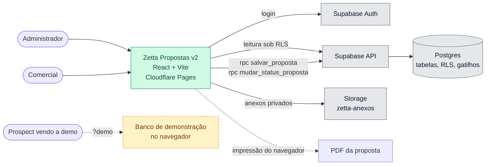

Não há servidor próprio (D-001). O navegador usa a chave pública; quem garante as regras é o banco: RLS em todas as tabelas e duas funções como únicas portas de escrita das propostas (D-002).

## 2. Organização do código

```
src/
├── main.jsx, App.jsx        # moldura, login, carregamento, rotas e menu por perfil (D-024)
├── styles.css               # tokens claro/escuro, vidro, movimento (D-020)
├── assets/marca/            # logo ZettaMinds (normal, com "Zetta" em branco, símbolo)
├── lib/
│   ├── api.js               # interface única de dados: Supabase ou demonstração
│   ├── supabase.js          # cliente com a chave pública (lida de src/config.js, D-018)
│   ├── demo.js              # banco fictício no navegador, com "Ver como" (D-016, D-024)
│   ├── business.js          # regras puras: totais, transições, vencimentos, fechamentos, métricas (testadas)
│   ├── planilha.js          # leitura de .xlsx/.csv e geração de .xlsx (D-025), carregado sob demanda
│   ├── anima.js             # números e gráficos animados, indicador deslizante, aparência
│   ├── format.js            # moeda, datas, "há 3 dias", horários
│   └── rota.js              # rotas por hash (D-015)
├── components/              # Icon, ui (controles, gavetas, cartões), graficos (SVG, D-021), Anexos, Linha
└── pages/                   # VisaoGeral, Propostas, PropostaDetalhe, Solicitacoes, Clientes, Relatorios,
                             # Pessoas, Fechamentos, Equipe, Login
supabase/
├── 01_estrutura.sql         # banco comercial
├── 02_admin_inicial.sql     # primeiro administrador
├── 03_primeiro_admin.sql    # gatilho do primeiro administrador
├── 04_pessoas_fechamentos.sql  # v4: perfis, pessoas, fechamentos, acesso por área
└── testes/                  # stub do Supabase + testes do banco (testes_banco.sql, testes_04.sql)
tests/                       # regras (business.test.js) e v4 (v4.test.js): npm test
```

## 3. O que acontece ao abrir o app

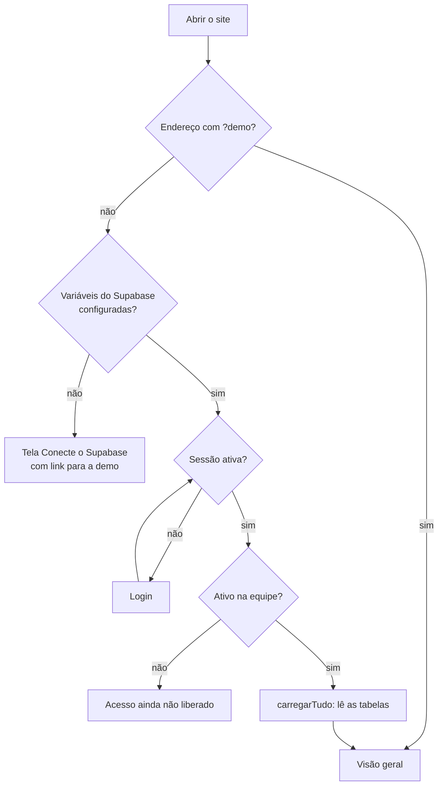

Depois de cada gravação o app recarrega os dados e mostra "Atualizado às hh:mm" no topo. Funciona bem até algumas centenas de propostas (R-06).

## 4. Jornada principal

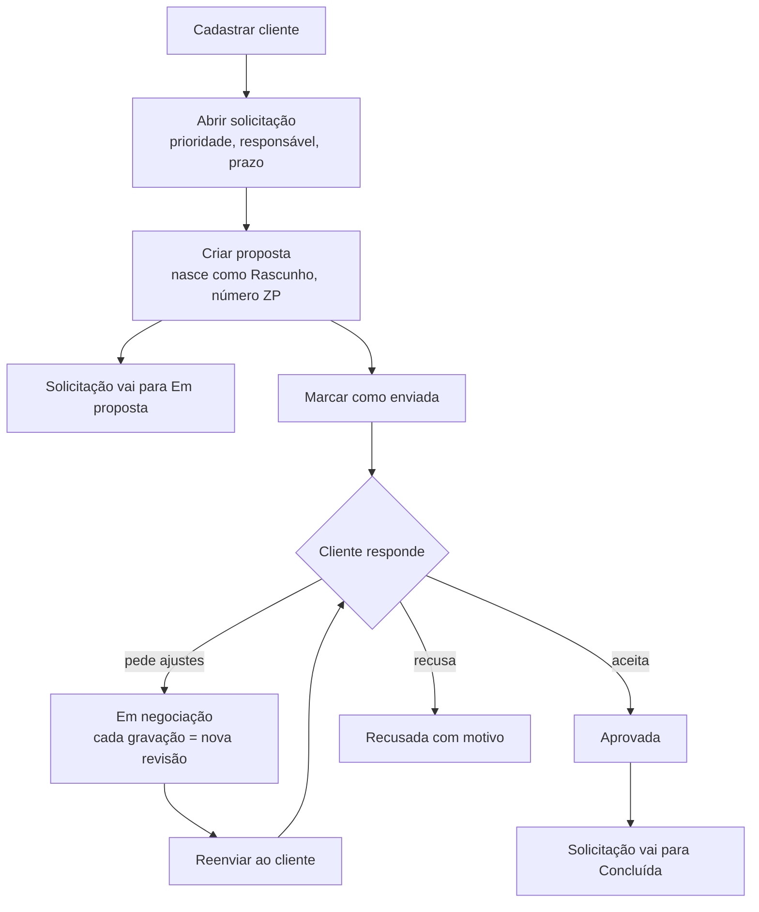

## 5. Ciclos de status

### Proposta (D-007, D-008)

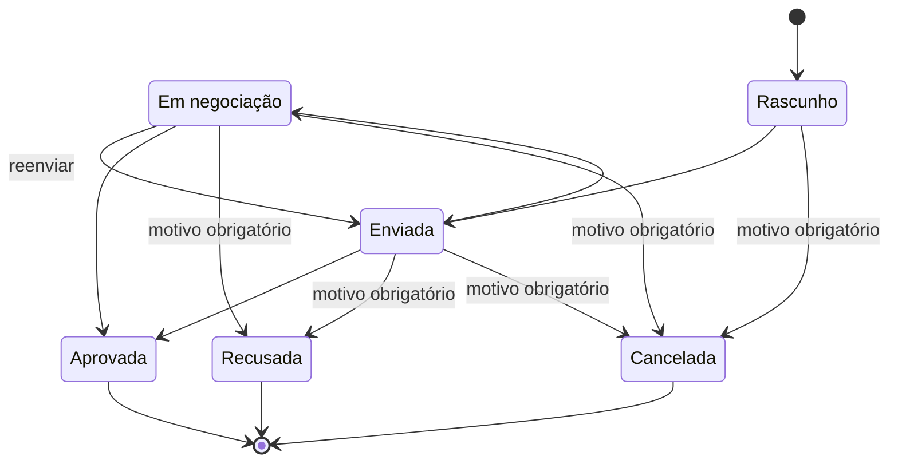

Qualquer outra transição é recusada pelo banco com a mensagem "Uma proposta X não pode passar para Y". Aprovada, Recusada e Cancelada são finais: a proposta deixa de ser editável.

### Solicitação (D-010)

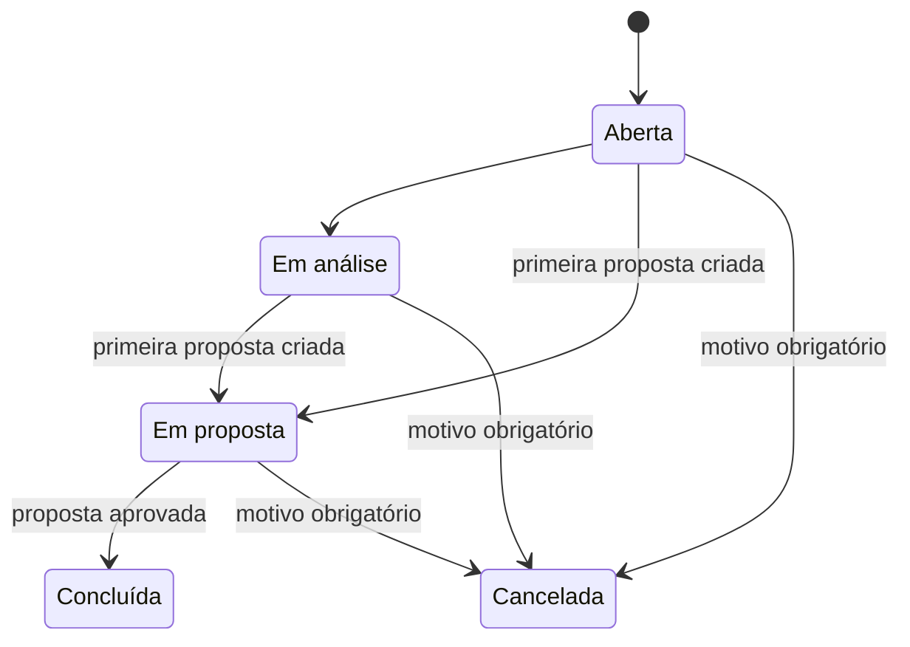

A solicitação ainda pode ter o status trocado à mão na tela; toda troca fica no histórico de status. Não se cria proposta em solicitação Concluída ou Cancelada.

## 6. Modelo de dados

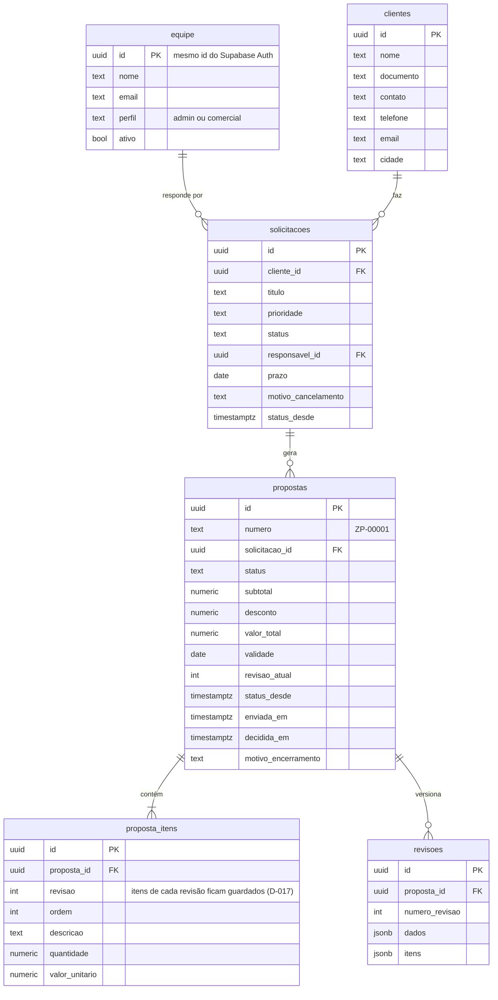

Tabelas de apoio, ligadas por `entidade` + `registro_id`: `status_historico` (cada mudança de status, D-009), `historico` (auditoria legível) e `anexos` (arquivos no bucket privado).

## 7. Operações críticas

### Salvar proposta (D-002, D-003)

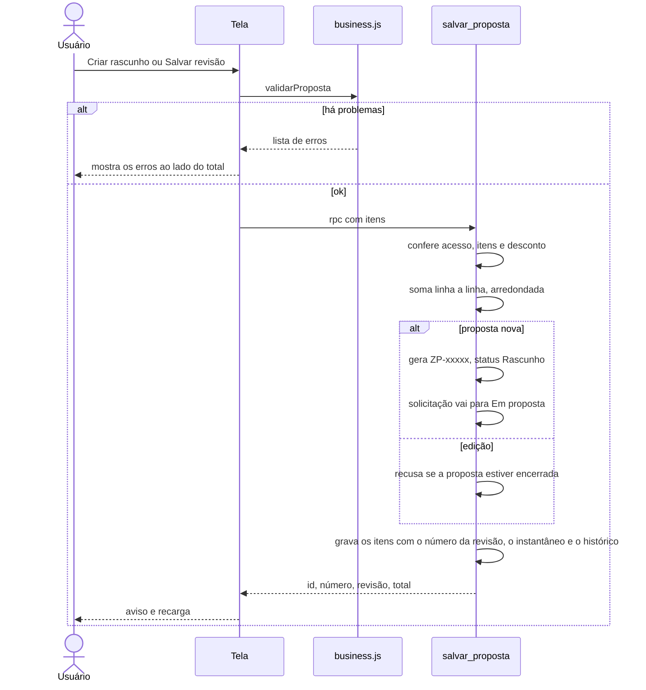

### Mudar status (D-007 a D-010)

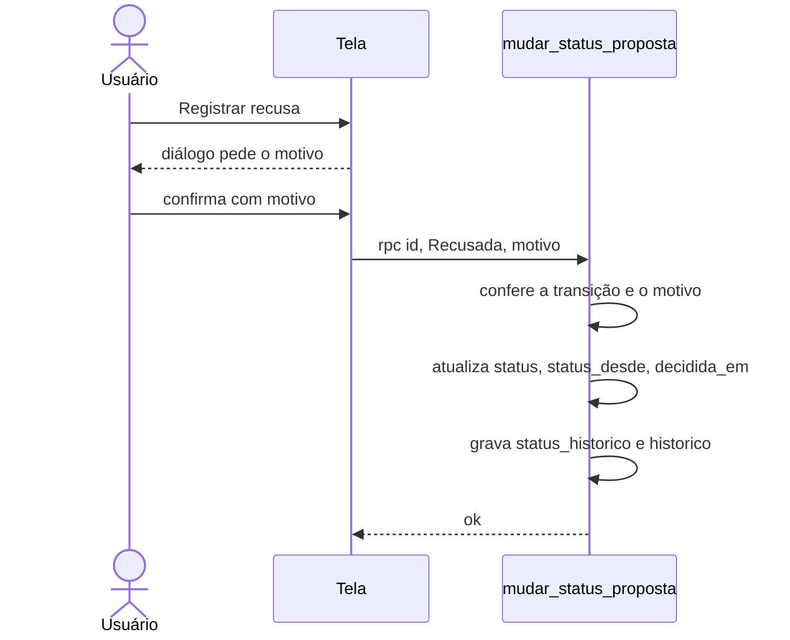

## 8. Regras de negócio

| Regra | Onde é aplicada | Status |
|---|---|---|
| Só entra quem está ativo em `equipe` | RLS (`e_membro()`) + tela | 🧪 |
| Só administrador inclui ou altera integrantes | RLS (`e_admin()`) + tela | 🧪 |
| Primeiro admin automático para os e-mails de José, só com login confirmado | gatilho `zetta_primeiro_admin` em `auth.users` | 🧪 |
| Ninguém tira o próprio acesso de administrador; sempre resta um admin ativo | gatilho `proteger_equipe` | 🧪 |
| Propostas só são gravadas pelas duas funções | RLS sem política de escrita | 🧪 (D-002) |
| Quantidade > 0, valor unitário ≥ 0, desconto ≤ subtotal | `salvar_proposta` + `business.js` | 🧪 |
| Total = soma das linhas arredondadas − desconto | `salvar_proposta` + `business.js` | 🧪 |
| Toda gravação cria uma revisão | `salvar_proposta` | 🧪 (D-003) |
| Transições permitidas e status finais | `transicao_proposta_valida` + `business.js` | 🧪 (D-007) |
| Recusa e cancelamento com motivo | `mudar_status_proposta` + restrição na tabela | 🧪 (D-008) |
| Cancelar solicitação exige motivo | restrição `solicitacao_cancelada_tem_motivo` | 🧪 |
| Cliente com solicitação não pode ser excluído | chave estrangeira `on delete restrict` | 🧪 |
| Anexo de até 10 MB, bucket privado, link temporário de 60 s | Storage + `api.js` | 🧪 |
| "Precisa de ação": validade vencida ou em até 7 dias, enviada sem resposta há 7+ dias, rascunho parado há 5+ dias, solicitação com prazo vencido | `precisaAcao()` em `business.js` | 🧪 |
| Conversão = aprovadas ÷ (aprovadas + recusadas) pela data da decisão | `taxaConversao()` | 🧪 |
| CSV protege células que começam com `= + - @` | `paraCsv()` | 🧪 |

## 9. Integrações e segredos

| Serviço | Para quê | Variáveis |
|---|---|---|
| Supabase | banco, login, API, arquivos | projeto `zetta-propostas` (`vbpktfmngjirwasawktx`), URL e chave publicável em `src/config.js` (D-018) |
| Cloudflare Workers (Workers Builds) | Worker `zettatestweb`: build `npm run build`, deploy `npx wrangler deploy` com `wrangler.jsonc` (arquivos de `dist/`, modo SPA) | nenhuma obrigatória; opcional `VITE_MODO_DEMO=true` (variável de build) para um site só de demonstração |
| Google Fonts | Inter (alternativa ao SF Pro fora dos aparelhos Apple, D-020) | nenhuma |
| fflate (npm) | descompactar as planilhas .xlsx para a prévia (D-025) | nenhuma |

Nunca usar `service_role`, `sb_secret_...` ou a senha do banco em variável `VITE_`: elas vão para o navegador.

## 10. Pessoas e fechamentos (v4)

Arquivo do banco: `supabase/04_pessoas_fechamentos.sql`, executado depois do `01_estrutura.sql` (idempotente). Testes: `supabase/testes/testes_04.sql`. Aplicado no projeto `zetta-propostas` em 03/11/2026.

### Quem acessa o quê (D-024)

| Área | Administrador | Comercial | Operacional |
|---|---|---|---|
| Clientes, solicitações, propostas e relatório comercial | lê e grava | lê e grava | — |
| Pessoas (funcionários, treinamentos, documentos e arquivos deles) | lê e grava | — | — |
| Fechamentos: ver, enviar e reenviar | sim | sim | sim |
| Fechamentos: conferir, apontar divergência, dia sem expediente, ajustes, excluir | sim | — | — |
| Equipe e acessos | gerencia | vê | só os nomes (para saber quem enviou) |

No banco: `e_membro()` = administrador ou comercial (as políticas da v2 ficaram iguais), `e_da_equipe()` = qualquer integrante ativo, `pode_acessar(entidade)` decide histórico, anexos e arquivos. No Storage, a primeira pasta do caminho é a entidade (`fechamentos/`, `treinamentos/`, `propostas/`…).

### Modelo de dados

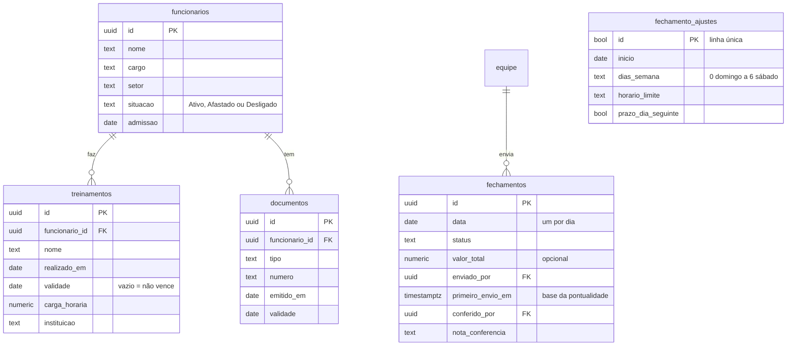

Planilhas, certificados e cópias ficam em `anexos` (entidade `fechamentos`, `treinamentos`, `documentos` ou `funcionarios`). O histórico das pessoas fica todo na entidade `funcionarios`, inclusive o dos treinamentos e documentos.

### Ciclo de um fechamento (D-023)

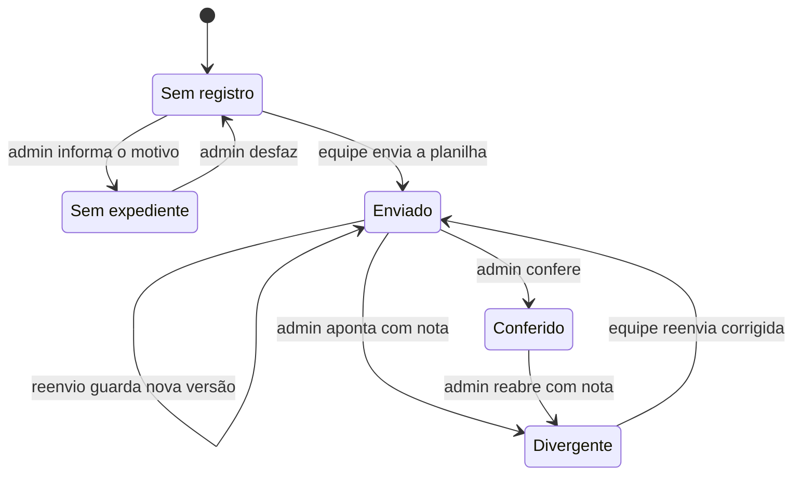

Sem registro, o dia aparece como **pendente** até o horário limite e depois como **sem fechamento**; dias fora da escala (por padrão, domingo) e anteriores ao início do controle não contam. Quem não é administrador não reenvia um dia conferido nem envia em dia sem expediente (a função recusa).

### Enviar o fechamento

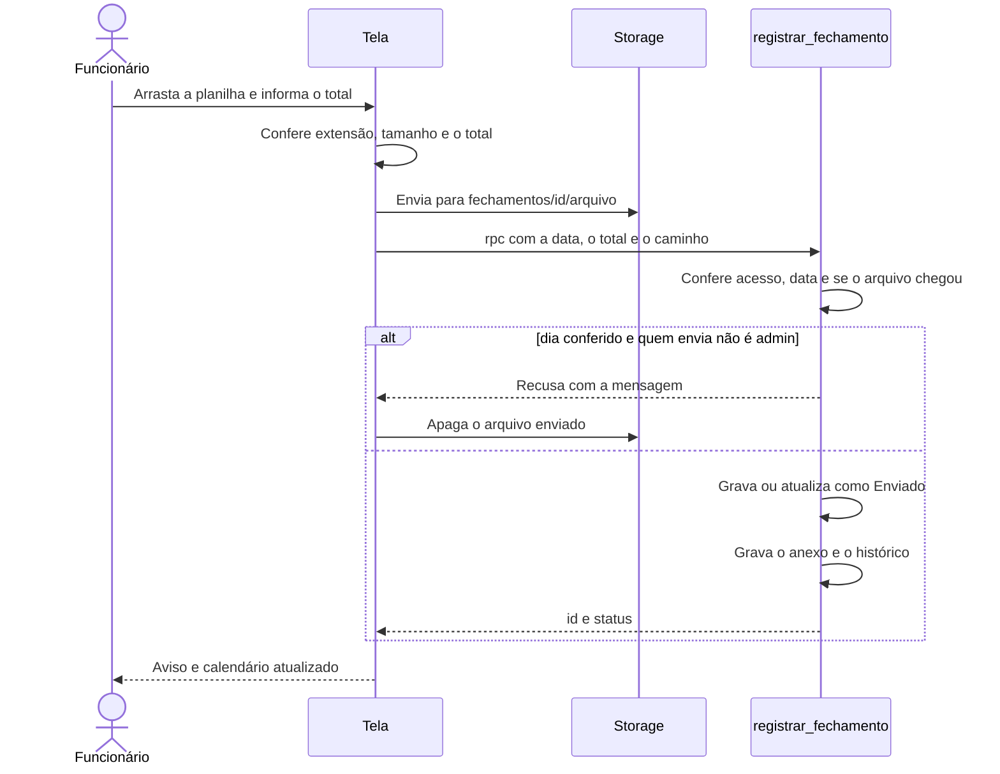

### Regras da v4

| Regra | Onde é aplicada | Status |
|---|---|---|
| Vale o treinamento ou documento mais recente de cada pessoa + nome; os anteriores são "renovados" | `idsVigentes()` em `business.js` | 🧪 (D-022) |
| Pede atenção 30 dias antes de vencer; "vale até hoje" ainda vale (vence hoje) | `situacaoValidade()` | 🧪 |
| Validade não pode ser anterior à realização ou à emissão | restrições nas tabelas + tela | 🧪 |
| Desligados saem dos vencimentos; quem tem registros não é excluído | `vencimentos()` + chave estrangeira | 🧪 |
| Registro com anexo só é excluído depois dos anexos (sem arquivo órfão) | gatilho `bloquear_exclusao_com_anexos` + `api.js` | 🧪 |
| Um fechamento por dia; fechamento novo exige a planilha (até 10 MB, já no Storage, na pasta `fechamentos/`) | `unique(data)` + `registrar_fechamento` | 🧪 (D-023) |
| Divergência exige nota; dia sem expediente exige motivo | restrições na tabela | 🧪 |
| Reenvio volta para Enviado, limpa a conferência e guarda a planilha anterior | `registrar_fechamento` + gatilho `fechamento_regras` | 🧪 |
| Pontualidade = primeiro envio até o horário limite (do dia ou do dia seguinte) | `enviadoNoPrazo()` + `primeiro_envio_em` | 🧪 |
| Cobertura = dias enviados ÷ (enviados + sem fechamento), até hoje | `resumoFechamentos()` | 🧪 |
| Quem enviou só apaga do Storage arquivo de fechamento ainda não registrado (limpeza de envio que falhou) | política `zetta_anexos_excluir` + `anexo_registrado()` | 🧪 (D-024) |
| Prévia lê `.xlsx`, `.xlsm` e `.csv` (até 300 linhas e 40 colunas por aba) | `planilha.js` | 🧪 (D-025) |

