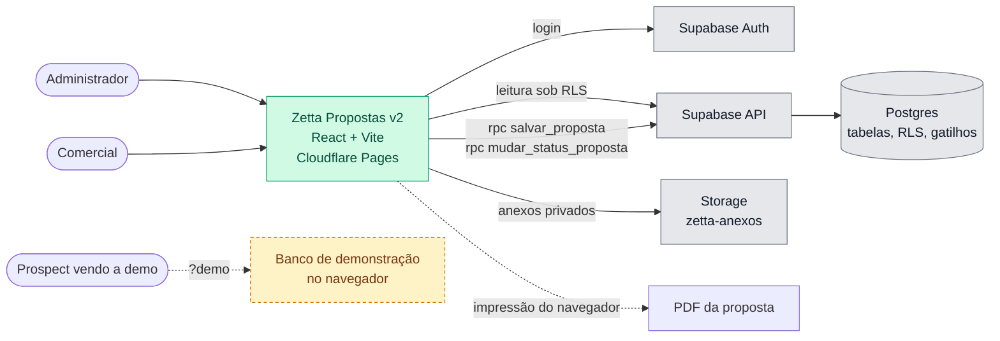
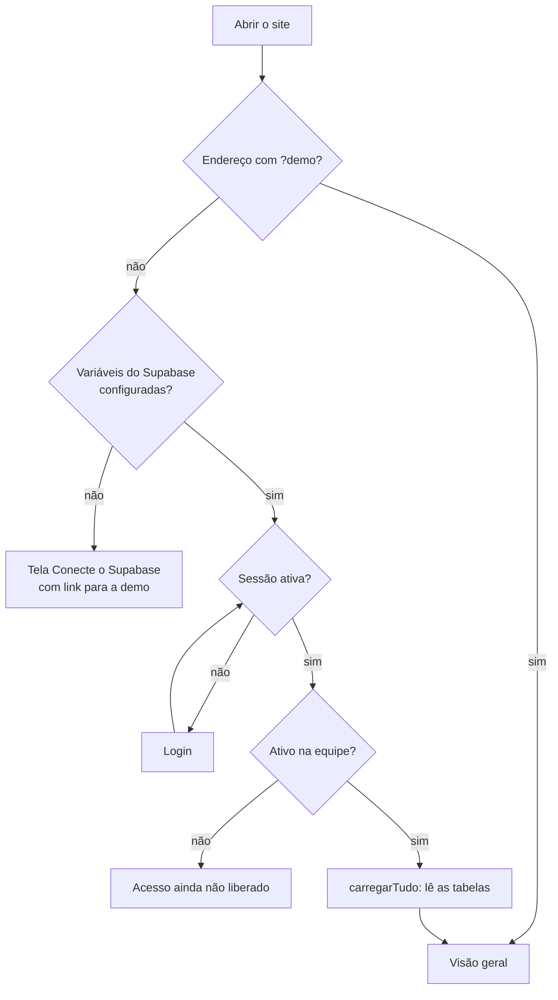
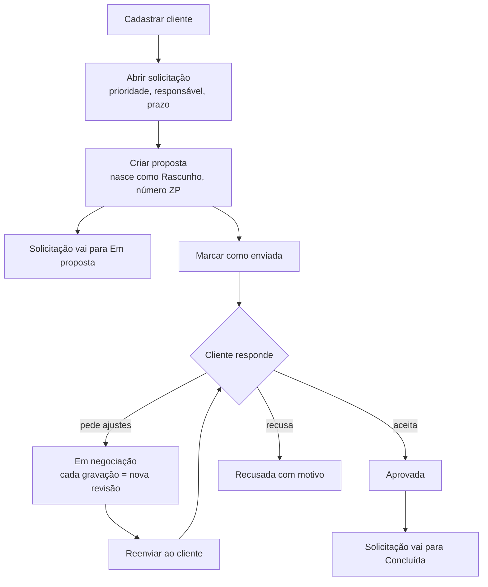
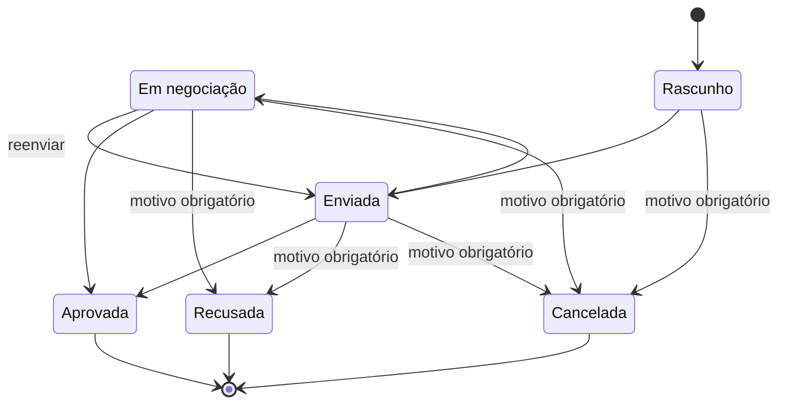
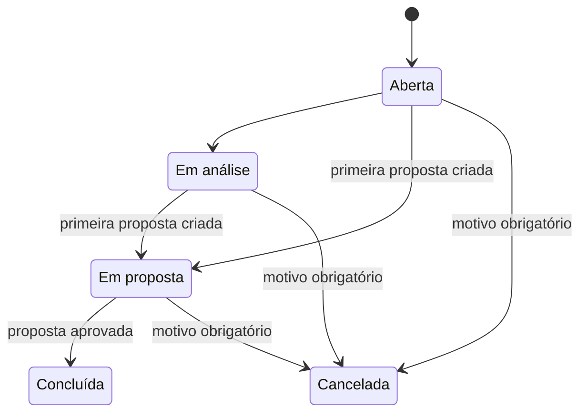
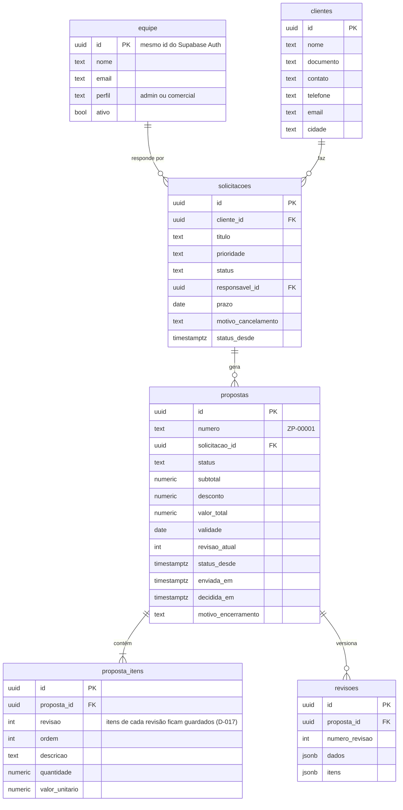
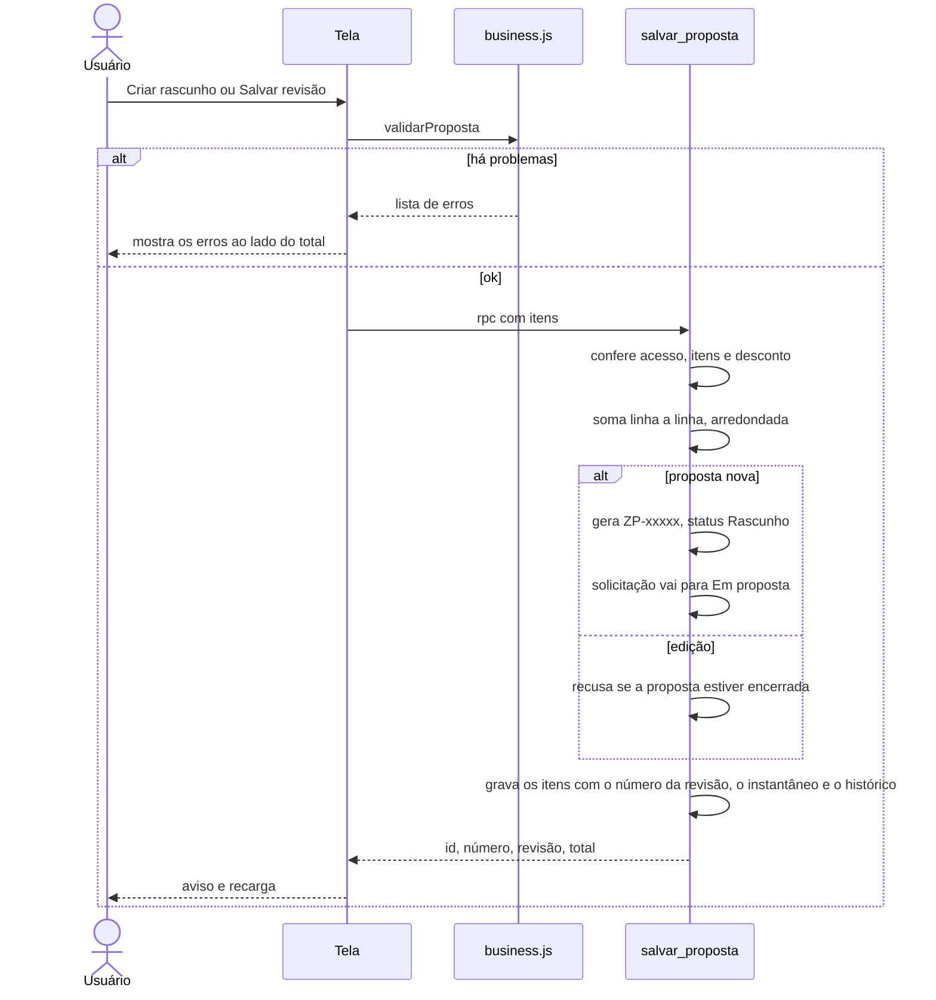
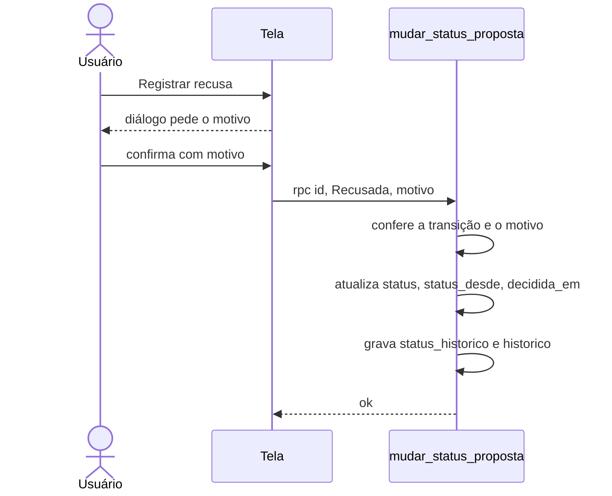

# Arquitetura — Zetta Propostas (v2)

> Como o sistema funciona por trás da tela, na versão 2 (28/10/2026). Cada regra cita a decisão que a motivou (D-xxx em [Decisões](04-decisoes.md)). A arquitetura da v1, reconstruída do código antigo, ficou registrada no histórico do repositório.

Legenda: verde = decidido · amarelo tracejado = hipótese · cinza = serviço externo.

## 1. Contexto



Não há servidor próprio (D-001). O navegador usa a chave pública; quem garante as regras é o banco: RLS em todas as tabelas e duas funções como únicas portas de escrita das propostas (D-002).

## 2. Organização do código

```
src/
├── main.jsx, App.jsx        # moldura, login, carregamento e rotas
├── styles.css               # tokens e estilo (D-019: gradiente ZettaMinds)
├── assets/marca/            # logo ZettaMinds (normal, com "Zetta" em branco, símbolo)
├── lib/
│   ├── api.js               # interface única de dados: Supabase ou demonstração
│   ├── supabase.js          # cliente com a chave pública (lida de src/config.js, D-018)
│   ├── demo.js              # banco fictício no navegador (D-016)
│   ├── business.js          # regras puras: totais, transições, prazos (testadas)
│   ├── format.js            # moeda, datas, "há 3 dias"
│   └── rota.js              # rotas por hash (D-015)
├── components/              # Icon, ui (botões, campos, KPIs, gráficos), Anexos, Linha
└── pages/                   # VisaoGeral, Propostas, PropostaDetalhe, Solicitacoes, Clientes, Relatorios, Equipe, Login
supabase/
├── 01_estrutura.sql         # banco completo
├── 02_admin_inicial.sql     # primeiro administrador
└── testes/                  # stub do Supabase + testes de comportamento do banco
tests/business.test.js       # testes das regras (npm test)
```

## 3. O que acontece ao abrir o app



Depois de cada gravação o app recarrega os dados e mostra "Atualizado às hh:mm" no topo. Funciona bem até algumas centenas de propostas (R-06).

## 4. Jornada principal



## 5. Ciclos de status

### Proposta (D-007, D-008)



Qualquer outra transição é recusada pelo banco com a mensagem "Uma proposta X não pode passar para Y". Aprovada, Recusada e Cancelada são finais: a proposta deixa de ser editável.

### Solicitação (D-010)



A solicitação ainda pode ter o status trocado à mão na tela; toda troca fica no histórico de status. Não se cria proposta em solicitação Concluída ou Cancelada.

## 6. Modelo de dados



Tabelas de apoio, ligadas por `entidade` + `registro_id`: `status_historico` (cada mudança de status, D-009), `historico` (auditoria legível) e `anexos` (arquivos no bucket privado).

## 7. Operações críticas

### Salvar proposta (D-002, D-003)



### Mudar status (D-007 a D-010)



## 8. Regras de negócio

| Regra | Onde é aplicada | Status |
|---|---|---|
| Só entra quem está ativo em `equipe` | RLS (`e_membro()`) + tela | 🧪 |
| Só administrador inclui ou altera integrantes | RLS (`e_admin()`) + tela | 🧪 |
| Primeiro admin automático para os e-mails de José, só com login confirmado | gatilho `zetta_primeiro_admin` em `auth.users` | 🧪 |
| Ninguém tira o próprio acesso de administrador; sempre resta um admin ativo | gatilho `proteger_equipe` | 🧪 |
| Propostas só são gravadas pelas duas funções | RLS sem política de escrita | 🧪 (D-002) |
| Quantidade > 0, valor unitário ≥ 0, desconto ≤ subtotal | `salvar_proposta` + `business.js` | 🧪 |
| Total = soma das linhas arredondadas − desconto | `salvar_proposta` + `business.js` | 🧪 |
| Toda gravação cria uma revisão | `salvar_proposta` | 🧪 (D-003) |
| Transições permitidas e status finais | `transicao_proposta_valida` + `business.js` | 🧪 (D-007) |
| Recusa e cancelamento com motivo | `mudar_status_proposta` + restrição na tabela | 🧪 (D-008) |
| Cancelar solicitação exige motivo | restrição `solicitacao_cancelada_tem_motivo` | 🧪 |
| Cliente com solicitação não pode ser excluído | chave estrangeira `on delete restrict` | 🧪 |
| Anexo de até 10 MB, bucket privado, link temporário de 60 s | Storage + `api.js` | 🧪 |
| "Precisa de ação": validade vencida ou em até 7 dias, enviada sem resposta há 7+ dias, rascunho parado há 5+ dias, solicitação com prazo vencido | `precisaAcao()` em `business.js` | 🧪 |
| Conversão = aprovadas ÷ (aprovadas + recusadas) pela data da decisão | `taxaConversao()` | 🧪 |
| CSV protege células que começam com `= + - @` | `paraCsv()` | 🧪 |

## 9. Integrações e segredos

| Serviço | Para quê | Variáveis |
|---|---|---|
| Supabase | banco, login, API, arquivos | projeto `zetta-propostas` (`vbpktfmngjirwasawktx`), URL e chave publicável em `src/config.js` (D-018) |
| Cloudflare Workers (Workers Builds) | Worker `zettatestweb`: build `npm run build`, deploy `npx wrangler deploy` com `wrangler.jsonc` (arquivos de `dist/`, modo SPA) | nenhuma obrigatória; opcional `VITE_MODO_DEMO=true` (variável de build) para um site só de demonstração |
| Google Fonts | IBM Plex Sans e Plex Mono | nenhuma |

Nunca usar `service_role`, `sb_secret_...` ou a senha do banco em variável `VITE_`: elas vão para o navegador.
