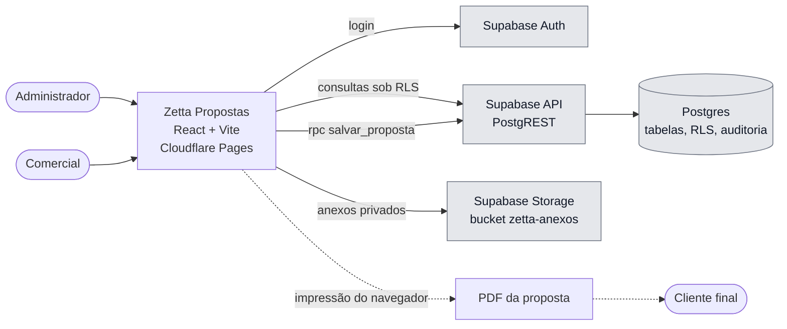
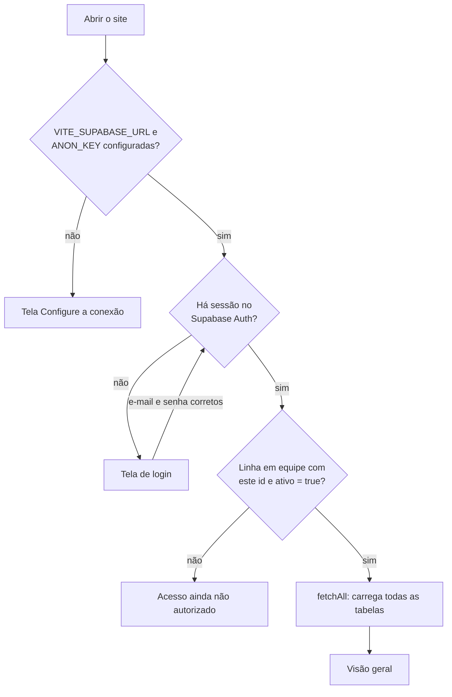
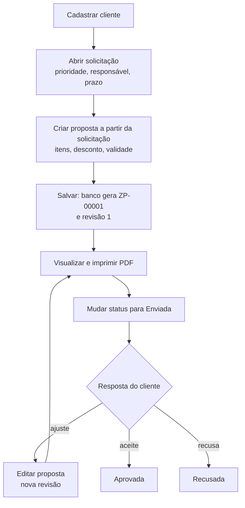
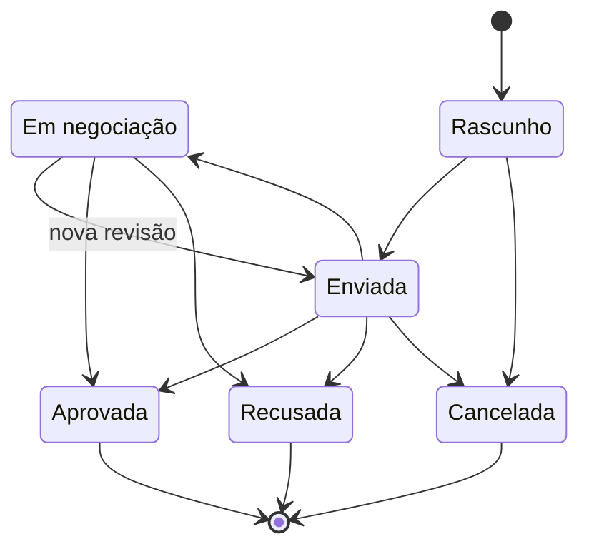
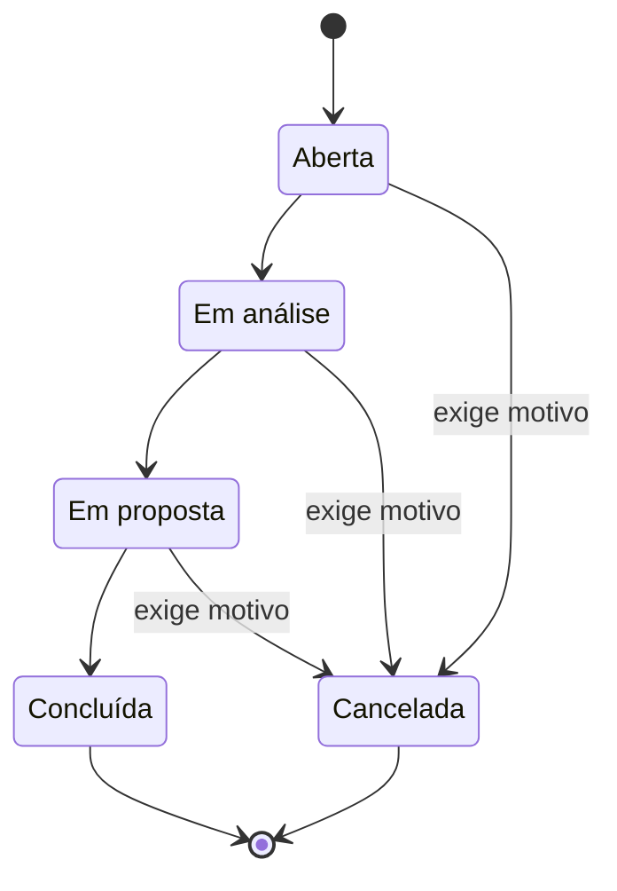
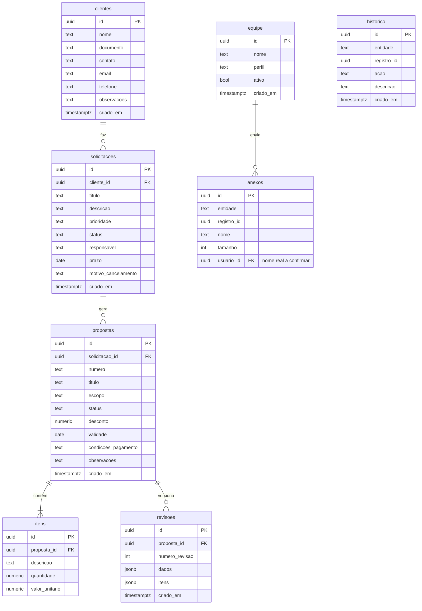
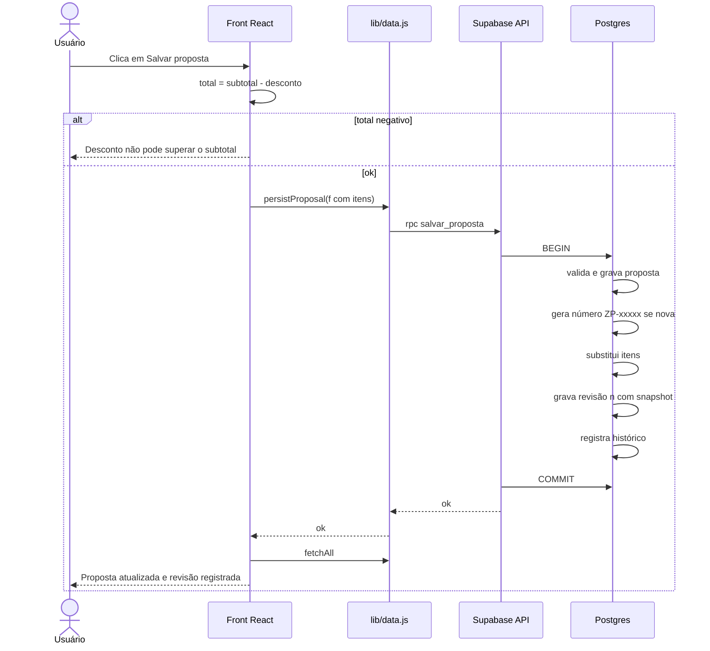
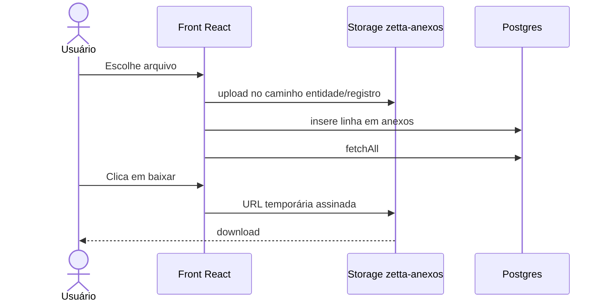

# Arquitetura — Zetta Propostas

> Como o sistema funciona por trás da tela. Tudo aqui foi extraído do código em 28/10/2026 (📌 observado) e indica o arquivo de origem. Partes que dependem de arquivos ausentes do repositório (`src/lib/*`, `supabase/*.sql`) foram deduzidas pelos nomes das funções e pelo README e estão marcadas como **dedução**.

Legenda dos diagramas: cinza = serviço externo · tracejado = dedução, confirmar no SQL.

## 1. Contexto

Não existe servidor próprio: o navegador fala direto com o Supabase usando a chave pública, e a segurança depende das políticas RLS e da função `salvar_proposta` (README, seção "Por que não há um servidor").

## 2. O que acontece ao abrir o app

Fonte: `App()` em `src/App.jsx`, linhas 150–167.

Depois de carregar, **todas** as telas trabalham sobre os dados em memória. Cada gravação chama `refresh()`, que busca tudo de novo (`onDone`, linha 157). Funciona bem com poucos registros; com milhares, ficará lento (R-06).

## 3. Jornada principal

Travas observadas no front (`openNew`, linha 159): não deixa criar solicitação sem cliente cadastrado nem proposta sem solicitação.

📌 A solicitação **não muda de status sozinha** quando ganha uma proposta ou quando a proposta é aprovada; o usuário muda à mão (P-05).

## 4. Ciclos de status

### Proposta (`SP`, linha 27)

Fluxo esperado:

📌 **No código, nenhuma transição é imposta**: o status é um `select` livre no formulário. É possível, por exemplo, voltar uma proposta Aprovada para Rascunho. Se a função `salvar_proposta` não validar isso, as métricas de conversão podem ser distorcidas (R-03).

### Solicitação (`SC`, linha 26)

O motivo de cancelamento é obrigatório só no formulário (campo `required`) e é apagado se o status deixar de ser Cancelada (linha 75).

## 5. Modelo de dados

Deduzido das chaves de `emptyData` (linha 29) e dos campos usados nos formulários. Os nomes reais das tabelas e os tipos precisam ser confirmados em `supabase/01_migracao.sql`.

Observações:
- `equipe.id` é o mesmo UUID do usuário no Supabase Auth.
- `anexos` e `historico` são polimórficas: `entidade` ("solicitacoes" ou "propostas") + `registro_id`. Não há chave estrangeira real, então apagar um registro pode deixar anexos órfãos.
- `solicitacoes.responsavel` é texto livre, não uma referência a `equipe` (P-06).
- O total da proposta **não é gravado**: é recalculado no front a partir dos itens menos o desconto (`totalP`, linha 36).

## 6. Operações críticas

### Salvar proposta

Fonte: `ProposalModal.submit` (linha 95) e README. O interior da função é dedução.

### Anexar arquivo

Fonte: `Attachments` (linha 64). O interior de `uploadAttachment` é dedução.

## 7. Regras de negócio

| Regra | Onde é aplicada | Status |
|---|---|---|
| Só entra quem tem linha ativa em `equipe` | front (linha 156) + RLS (README) | 📌 observado |
| Só admin vê botão de adicionar/editar integrante | front (`Team`) | 📌 observado; RLS precisa reforçar |
| Admin não pode remover o próprio acesso de admin | front (`MemberModal`) | 📌 observado |
| Cliente com solicitação não pode ser excluído | banco (mensagem no front) | 📌 dedução |
| Solicitação exige cliente; proposta exige solicitação | front (`openNew`) + FK no banco | 📌 observado |
| Desconto não pode deixar o total negativo | front (linha 95) | 📌 observado; banco? |
| Quantidade mínima 0,01 e valor unitário ≥ 0 | atributos HTML `min` | 📌 observado; fraco |
| Toda gravação de proposta gera revisão | função `salvar_proposta` | 📌 observado no README |
| Motivo obrigatório ao cancelar solicitação | front (`required`) | 📌 observado |
| Transições de status | **nenhum lugar** | 📌 observado (R-03) |
| Conversão = aprovadas ÷ (aprovadas + recusadas) | `lib/business.js` (ausente) | 📌 observado pelo uso |
| Anexo até 10 MB | README; não há checagem no front | 📌 observado |
| CSV escapa células iniciadas por `= + @ -` | front (`Reports.csv`) | 📌 observado |

## 8. Integrações e segredos

| Serviço | Para quê | Variáveis |
|---|---|---|
| Supabase | banco, login, API, arquivos | `VITE_SUPABASE_URL`, `VITE_SUPABASE_ANON_KEY` (chave pública) |
| Cloudflare Pages | build e hospedagem | as duas acima, em Settings → Environment variables |

Nunca usar `service_role` ou senha do banco em variável `VITE_`: elas vão para o navegador.
